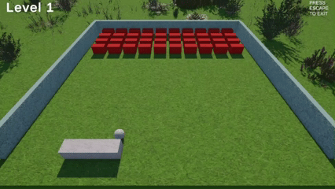

# Bricks3D



A modern 3D recreation of the classic Breakout game built with **Unity**.

Instead of a 2D paddle and bricks, Bricks3D takes the gameplay into a 3D world with dynamic lighting, particle effects, power-ups, and procedurally generated foliage.

This project was built as part of my journey learning Unity game development.

---

## Gameplay

Control the paddle and keep the ball in play while destroying every brick on the board.

As you progress, the game introduces stronger bricks and special power-ups that change the gameplay.

---

## Features

### Levels

#### Level 1 - Normal Bricks
- Classic Breakout gameplay
- One hit destroys a brick

#### Level 2 - Tough Bricks
- Tough bricks require multiple hits
- Increased challenge and longer rallies

#### Level 3 - Brick Spawners
- Blue spawner bricks continuously throw new red bricks onto the board
- New bricks only occupy vacant positions
- Destroy the spawners before they refill the board

---

## Power Ups

### Aim Assist
- Slows the ball slightly
- Shows the predicted bounce path
- Makes precision shots easier

### Electric Ball
- The ball becomes electrically charged
- Chains through multiple nearby bricks
- Excellent for clearing clustered bricks

### Bomb
- Floats for a limited time after spawning
- Triggered when hit by the ball
- Explodes and destroys nearby bricks

---

## Visual Features

- Fully 3D gameplay
- Dynamic lighting
- Particle effects
- Explosion effects
- Randomized sun position for each level
- Physics-based ball movement

---

## Controls

| Key | Action |
|------|--------|
| A/D | Move paddle |
| Space | Launch ball (if applicable) |
| Esc | Pause / Quit |

---

## Built With

- Unity
- C#
- Unity Physics
- TextMesh Pro

---

## Current Learning Goals

This project is helping me learn:

- Unity component architecture
- Physics-based gameplay
- Prefab workflows
- Game state management
- Power-up systems
- Procedural gameplay mechanics
- Clean, reusable C# code

---

## Planned Features

- [x] Normal bricks
- [x] Tough bricks
- [x] Aim Assist power-up
- [x] Electric Ball power-up
- [x] Bomb power-up
- [x] Brick Spawner level
- [ ] Sound settings
- [ ] Difficulty modes
- [ ] High score system
- [ ] More power-ups
- [ ] Mobile support

---

## How to Run

1. Clone the repository

```bash
git clone https://github.com/sana167/Bricks3D.git
```

2. Open the project in Unity.

3. Open the main scene.

4. Press **Play**.

---

## Repository

GitHub:
https://github.com/sana167/Bricks3D

---

## License

This project is intended for learning and personal use.

Feel free to fork it, experiment, and build your own version.

---

## Acknowledgements

Inspired by the classic **Breakout** arcade game while exploring Unity and C# game development. Learning game development has been much more enjoyable thanks to AI assistants.

Special thanks to:

- **Google Gemini** for helping me explore ideas, solve programming problems, and learn Unity.
- **OpenAI ChatGPT** for explaining concepts, reviewing code, suggesting improvements, and helping design new gameplay features.

This project is ultimately a product of curiosity, experimentation, lots of debugging, and many iterations.
